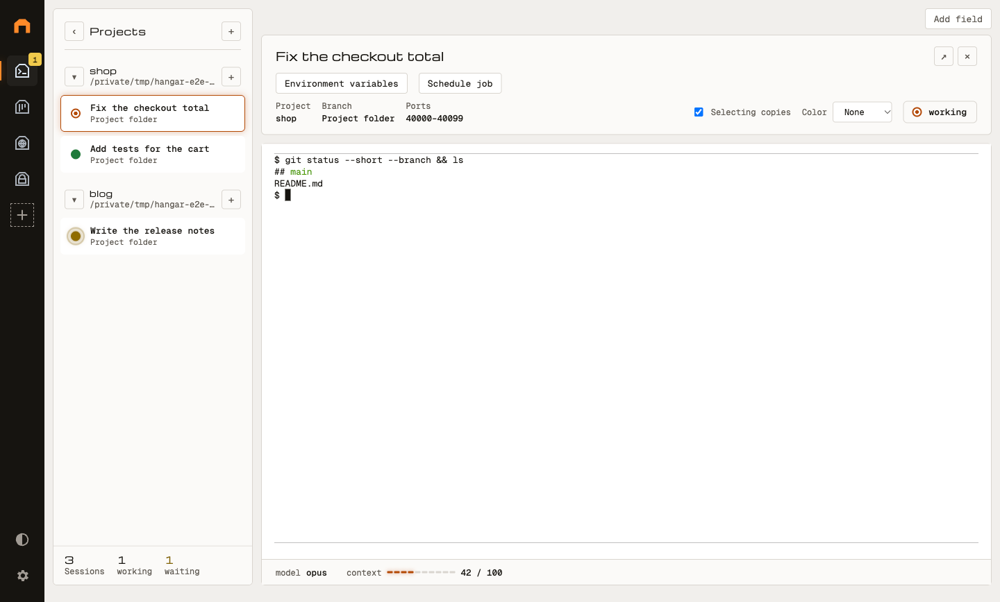

# Hangar

A desktop cockpit for running several AI agent sessions side by side: each
session is a shell with its status on view, next to a browser, a task board and
a password store your agents can use.

<picture>
  <source media="(prefers-color-scheme: dark)" srcset="docs/media/hangar-dark.png">
  
</picture>

## Why

Running Claude Code, Codex and friends in parallel quickly turns into a pile of
terminal tabs: which one is waiting for you, which one is done, which project
was that? Hangar keeps every session in one tree with a status light, a short
description and a status bar the agent fills itself. In the installed app on
macOS the sessions run in a local server, so they survive a restart of the app. Agents reach the other
bays through MCP: they open pages in their own browser tabs and take tasks from
the board; passwords reach their shell as environment variables, while the
password store itself stays closed to them.

## Features

- **Bays:** standalone applications in a sidebar on the left. The plus picks
  from the bays found, a right click removes one. Each bay runs isolated in
  its own view with its own data folder.
- **Agent bay** (`bays/agents`, `dev.hangar.agents`): projects and sessions in
  a tree; a new session is a shell in the project folder (ADR 0022; handovers
  get their own worktree, ADR 0031), agents report
  status, description and status bar through MCP or the `hangar` CLI.
- **Browser bay** (`bays/browser`, `dev.hangar.browser`): web pages in tabs;
  agents open their own tabs (own cookies per session), read text, click, fill
  in fields and take screenshots, for example of their dev server.
- **Board bay** (`bays/board`, `dev.hangar.board`): tasks per project in three
  columns; the person and agents create, claim and finish them (ADR 0037).
- **Password bay** (`bays/secrets`, `dev.hangar.secrets`): passwords and tokens
  encrypted with the system keychain; they reach a session's shell as
  environment variables, agents cannot list or read the store (ADR 0021).
- **Local server** (macOS, on by default in the installed app, off in
  `pnpm dev`; ADR 0036): the agents run in a LaunchAgent, so sessions keep
  running when the app quits or restarts.
- **Server and workspaces:** Hangar without a UI on another machine
  (ADR 0018), and workspaces that show the sessions of shared projects to
  other instances and pass shared function calls through an end-to-end
  encrypted relay; no project files are copied (ADR 0011, 0030).
- **Own bays:** signed `.bay` packages with a manifest and permissions
  (ADR 0033, [docs/bay-development.md](docs/bay-development.md)).

## Status

Version 0.1.0, early and still changing. Builds for macOS, Windows and Linux;
the local server is macOS only. What works and what is tested:
[docs/STATUS.md](docs/STATUS.md); next steps: [docs/roadmap.md](docs/roadmap.md).

## How it works

- The desktop app (`apps/desktop`) shows each bay in its own view; a bay's
  main part runs in the host process (`packages/host`) and talks to Hangar
  through the API of `packages/sdk`.
- Bays offer functions through a central bus (`packages/bus`), which checks
  every call against the permissions: granted by the person, or given by the
  manifest (own functions, `openToAgents`, declared non-sensitive calls).
- A local MCP server (`packages/mcp`, 127.0.0.1) makes these functions
  available to agents as tools named `<bay-id>/<function>`; each session gets
  its own token, which the MCP server maps to the session.
- The `hangar` CLI (`packages/cli`) calls the same tools from a shell.
- With the local server, the agent bay and its shells live in
  `hangar-server` (`apps/server`); the app connects to it over the bridge
  (`packages/bridge`).

Details: [docs/architecture.md](docs/architecture.md). Background:
[docs/concept.md](docs/concept.md); authoritative specification:
[docs/specification-mvp.md](docs/specification-mvp.md).

## Requirements

- Node.js 22.12 or newer (CI uses 24)
- pnpm 10 (version in `package.json` under `packageManager`)
- Git (for worktrees)

## Installation and start

```sh
pnpm install
pnpm dev
```

`pnpm install` repairs the file permissions of node-pty through `postinstall`
(`scripts/fix-node-pty.mjs`). `pnpm dev` builds the CLI and the bays and starts
the app in dev mode, with its own profile `~/Library/Application Support/Hangar Dev`
(projects, sessions and settings are kept apart from the built Hangar). So the
Hangar you work with (`pnpm package`, `release/`) and the one under development
run side by side, and a restart during development does not end working sessions.

Short form: `./start.sh` checks Node.js (22.12+) and pnpm, installs if needed
(missing or changed dependencies) and starts `pnpm dev`.

## For AI agents

In every session shell Hangar sets up automatically:

- the `hangar` CLI (a shim at the front of the `PATH` that uses Hangar's own
  binary; no separate Node installation needed),
- `.mcp.json` with the MCP server `hangar` and Claude Code hooks in
  `.claude/settings.local.json` that report the status of the session.

An agent then reports its state with, for example,
`hangar describe "Fix the checkout total" && hangar status working`, or calls
the tool `dev.hangar.agents/session.setStatus` over MCP. All tools and the
environment of a session: [docs/mcp.md](docs/mcp.md).

## Commands

| Command                                                   | Purpose                                                                           |
| --------------------------------------------------------- | --------------------------------------------------------------------------------- |
| `pnpm install`                                            | Dependencies (repairs node-pty permissions automatically)                         |
| `pnpm dev`                                                | Build CLI and bays, start the app in dev mode                                     |
| `./start.sh`                                              | Check Node/pnpm, install if needed, `pnpm dev`                                    |
| `pnpm lint`                                               | ESLint + Prettier check                                                           |
| `pnpm typecheck`                                          | `tsc --noEmit` over the whole repo                                                |
| `pnpm test`                                               | Vitest (unit, integration, components) with coverage gate                         |
| `pnpm test:e2e`                                           | Builds everything, then Playwright against the real Electron app                  |
| `pnpm build`                                              | Build all packages, bays and the app                                              |
| `pnpm package`                                            | Installer with electron-builder for the current OS                                |
| `pnpm create:bay <id>`                                    | Scaffold for a new bay                                                            |
| `pnpm pack:bay <id> [--key <file>]`                       | Signed `.bay` package to `dist/bays/` (ADR 0033); `--keygen <file>` creates a key |
| `node apps/server/dist/hangar-server.mjs --data <folder>` | Server without a UI (after `pnpm build`, `apps/server/CLAUDE.md`)                 |
| `pnpm dev:server [down]`                                  | Start/stop the dev server with SSH in Docker (ADR 0020)                           |
| `pnpm test:ssh`                                           | Start the dev server, check the bridge with a real `ssh` (Docker required)        |
| `pnpm image:server [tag]`                                 | Build the production image of the server (ADR 0029)                               |
| `pnpm image:relay [tag]`                                  | Build the image of the relay (ADR 0011, `docs/relay-operations.md`)               |
| `pnpm test:container`                                     | Build images, smoke tests with Docker (server and relay)                          |
| `pnpm docs:api`                                           | Generate the SDK API reference to `docs/api/`                                     |

## Repository layout

```
apps/desktop     Electron: window, sidebar, dialogs, tray, updates
apps/server      Hangar without a UI: bays, MCP and jobs in Node (ADR 0018)
docker/dev-server Hangar server with SSH in Docker, for development only (ADR 0020)
docker/server    Production image, Compose and systemd example (ADR 0029)
apps/relay       Relay between Hangar instances: WebSocket over TLS, sees no content (ADR 0011)
docker/relay     Image and Compose example of the relay
packages/bridge  Protocol and client for desktop ↔ server (ADR 0019)
packages/host    Core without Electron: bay loader, bay runtime, bus, MCP server, scheduler
packages/bus     Register functions, route calls, permissions (transport is replaceable)
packages/relay   Between instances: identity, member list, envelope, replay protection, relay client (ADR 0011)
packages/mcp     MCP server (Streamable HTTP, 127.0.0.1) on top of the bus, token → session
packages/scheduler Time-driven jobs (cron), without Electron
packages/sdk     API for bays (main + UI), manifest schema
packages/theme   Design tokens as CSS variables incl. dark mode
packages/cli     `hangar` command, talks to the MCP server over HTTP
bays/agents      Projects, sessions, shells (node-pty), status bar
bays/browser     Web pages in tabs, for the person and for agents (MCP)
bays/board       Tasks per project in three columns, for the person and agents
bays/secrets     Passwords and tokens, encrypted with the system keychain
docs/            Documentation and ADRs
.claude/skills/  Skills for recurring tasks
```

Every package and every bay has its own `CLAUDE.md` with purpose, interfaces
and pitfalls.

## Documentation

- [docs/architecture.md](docs/architecture.md) – packages, data flows, flow of
  a call, loading bays, lifecycle of a session
- [docs/bay-development.md](docs/bay-development.md) – developing your own bays
- [docs/mcp.md](docs/mcp.md) – MCP endpoint, environment of the session, tools,
  CLI
- [docs/server-operations.md](docs/server-operations.md) – Hangar server as a
  container or systemd service, backup, deploy keys, API keys
- [docs/relay-operations.md](docs/relay-operations.md) – running the relay
  between instances
- [docs/concept.md](docs/concept.md) and the `docs/concept-*.md` – background
  of server, relay and registry
- [docs/adr/](docs/adr/) – architecture decisions
- [docs/STATUS.md](docs/STATUS.md) – status, test results, gaps
- [docs/roadmap.md](docs/roadmap.md) – next phases
- [CHANGELOG.md](CHANGELOG.md)

## License

MIT – see [LICENSE](LICENSE).
