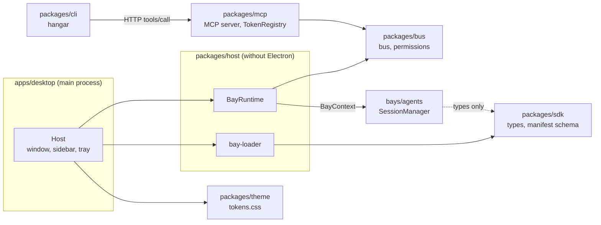
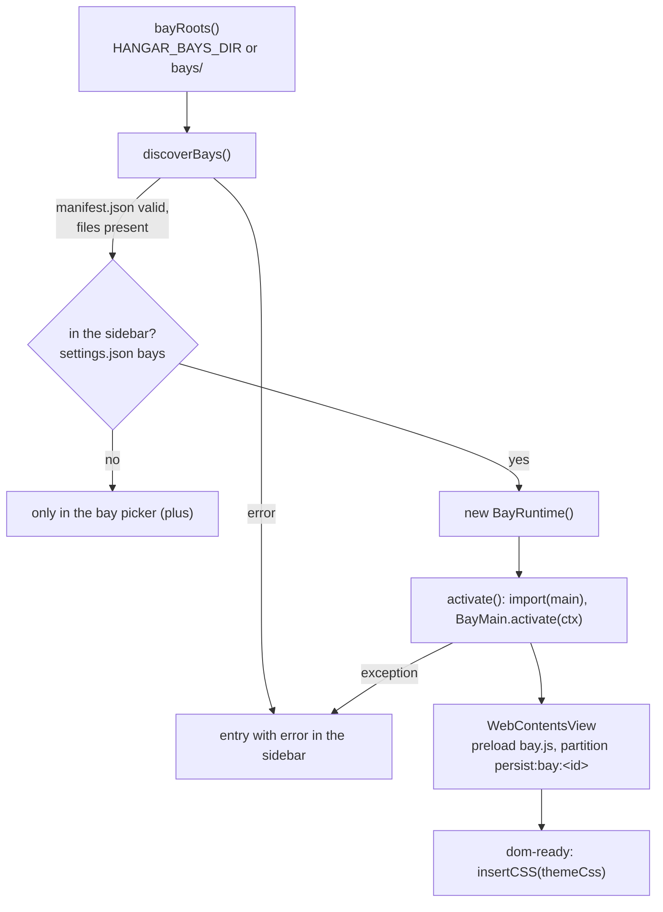
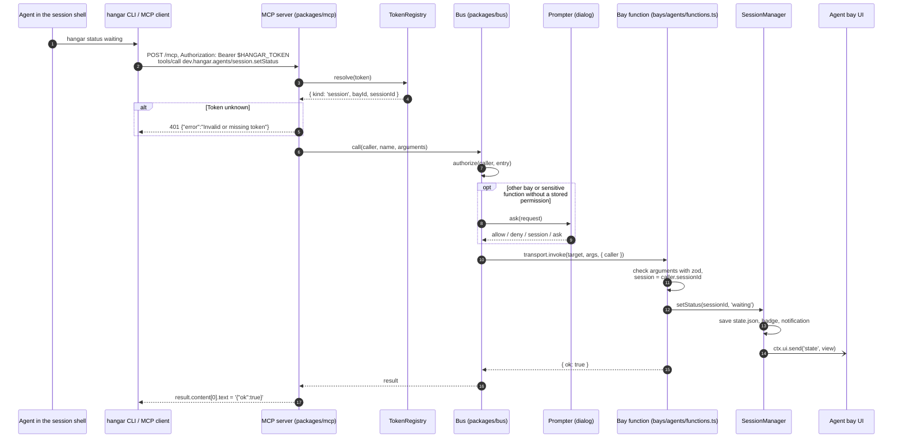
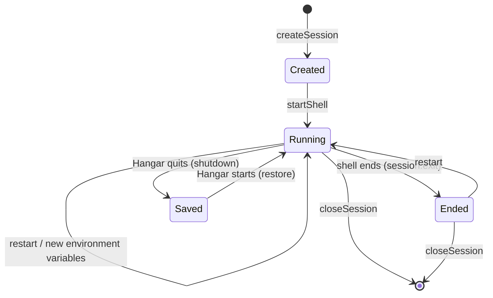

# Architecture

Overview of packages, data flows and procedures. Decisions and their reasons are
in the ADRs under [adr/](adr/).

## Packages

| Package              | Purpose                                                                                                      |
| -------------------- | ------------------------------------------------------------------------------------------------------------ |
| `apps/desktop`       | Electron main process: window, sidebar, dialogs, tray, notifications, browser tabs, updates                  |
| `apps/server`        | Node process without a UI: core, `/health`, permissions from rules only (ADR 0018)                           |
| `packages/bridge`    | Protocol desktop ↔ server and client (WebSocket, pairing, ADR 0019)                                          |
| `packages/host`      | Core without Electron: bay loader, bay runtime, `settings.json`, CLI shim, `startCore` (bus, MCP, scheduler) |
| `packages/bus`       | Registers bay functions, routes calls through a `Transport` interface, checks permissions                    |
| `packages/mcp`       | MCP server on top of the bus; `TokenRegistry` maps tokens to sessions                                        |
| `packages/scheduler` | Cron parser and `Scheduler` for jobs of the bays (`jobs.json`), without Electron                             |
| `packages/sdk`       | Types for bays (`BayMain`, `BayContext`, `HangarUiApi`) and the manifest schema (zod)                        |
| `packages/theme`     | Design tokens as CSS variables (`tokens.css`), light and dark                                                |
| `packages/cli`       | `hangar` command without dependencies; sends `tools/call` to the MCP server                                  |
| `bays/agents`        | Agent bay: projects, worktrees, shells (node-pty), sessions, status, status bar                              |
| `bays/browser`       | Browser bay: tabs through the host module `browser` (one `WebContentsView` per tab, ADR 0015)                |

`packages/sdk` depends on `packages/bus` for types only (`Caller`, `CallInfo`).
The main part of a bay sees only the `BayContext`, with no access to windows, the
bus or other bays (ADR 0004).

## App start

`apps/desktop/src/main/index.ts` does the following at start:

1. Determine the data folder (`HANGAR_USER_DATA` overrides `userData`; without a
   package it is otherwise `<appData>/Hangar Dev`, so development never touches
   the working profile).
2. Create `TokenRegistry` and `Bus`; stored permissions are in
   `<userData>/permissions.json` (`FilePermissionStore`), questions are asked by
   `dialogPrompter` as a native dialog.
3. Start the MCP server on `127.0.0.1` with a free port.
4. Write the CLI shim to `<userData>/bin` (`hangar` or `hangar.cmd`). It starts
   the bundled `hangar.mjs` with `ELECTRON_RUN_AS_NODE=1` and Hangar's own
   binary.
5. Create the `Scheduler` with `<userData>/jobs.json`, start the `Host` (find and
   activate bays, create window and tray), then the scheduler (check every
   15 seconds, ADR 0013).
6. Start auto-update (`updates.ts`, packaged builds only) with the channel from
   `<userData>/settings.json`.

Only one instance runs at a time (`requestSingleInstanceLock`). Closing the
window only hides it; bays and shells keep running. Only when the app quits
(e.g. "Quit" in the tray) does the host call `deactivate()` of each bay and
close the MCP server.

## Loading bays

- **Roots** (`host.ts`, `bayRoots()`): `HANGAR_BAYS_DIR` (a path list with the
  system's separator) replaces the default. Otherwise `<app>/bays` in the package
  or `bays/` of the repository in development.
- **Discovery** (`bay-loader.ts`, `discoverBays()`): Every subfolder with a
  `manifest.json` is checked. Errors are readable and appear in the sidebar:
  invalid JSON, schema violation (`parseManifest`), duplicate bay ID (the bay
  found first wins), Hangar version too old (`minHangarVersion`), missing files
  (`icon`, `ui`, `main`). Valid bays are sorted by name.
- **Sidebar** (ADR 0017): Only bays whose ID is listed in `settings.json` under
  `bays` run – in that order. The plus (`shell:addBay`) starts another one, the
  context menu (`shell:bayMenu`, "Remove from sidebar") ends it, closes its
  windows and tabs and unregisters its functions.
- **Runtime** (`bay-runtime.ts`, `BayRuntime`): loads `manifest.main` through a
  dynamic `import()` in the main process and calls `activate(ctx)`. Default
  exports from ESM and CommonJS are both recognized. If `activate` throws, the
  functions of the bay are removed from the bus and the bay is reported as
  "Start failed".
- **UI**: Every bay gets a `WebContentsView` with `sandbox: true`,
  `contextIsolation: true`, its own partition `persist:bay:<id>` and the preload
  `bay.js`, which provides `window.hangar`. The theme CSS is inserted at
  `dom-ready`. Navigation is blocked; `window.open` with an `http(s)` URL opens
  the default browser, everything else is rejected.
- **IPC**: `window.hangar.invoke` goes through the channel `bay:invoke` to the
  host, which maps the sender to its bay and calls `BayRuntime.handleUi`.
  `ctx.ui.send` sends through `bay:event` to the view of the bay and its windows.
- **Windows of a bay** (ADR 0010): `bay:window.open`, `bay:window.close` and
  `bay:window.list` open a `BrowserWindow` with the same `webPreferences` as the
  view and `?window=<key>` in the URL. Changes go as `bay:windows` to the view
  and windows; open windows are stored in `view.json`.

## Flow of a call

An agent in a session shell sets the status of its session, either through an MCP
client (e.g. Claude Code with `.mcp.json`) or through the `hangar` CLI. Both send
the same JSON-RPC call `tools/call` to the MCP server.

1. **CLI / MCP client** send `POST` to `HANGAR_MCP_URL` with
   `Authorization: Bearer $HANGAR_TOKEN`.
2. **MCP server** (`server.ts`) checks the path (`/mcp`, otherwise 404), resolves
   the token through the `TokenRegistry` to a caller
   `{ kind: 'session', bayId, sessionId }` (otherwise 401) and accepts only
   `POST` (otherwise 405). Every request gets its own MCP server instance
   (stateless, ADR 0007).
3. **Bus** (`bus.ts`) looks up the function `<bay-id>/<function>` and checks the
   permission (see [bay-development.md](bay-development.md#permissions)
   and ADR 0006). Functions of the agent bay are not sensitive; agents of the
   agent bay may call them without a question.
4. **Bay function** (`bays/agents/src/main/functions.ts`) checks the arguments
   with zod and always acts on the session of the caller (`caller.sessionId`).
5. **SessionManager** changes the state, writes `state.json`, updates the badge
   and sends the event `state` to the UI. On `waiting` it shows a system
   notification.
6. The result goes back as JSON text in the MCP result. Errors of the function
   are returned as `isError: true` with the error message as text.

## Lifecycle of a session

`SessionManager` in `bays/agents/src/main/sessions.ts` is responsible. The state
is in the data folder of the bay (`<userData>/bays/dev.hangar.agents/`).

**Create** (`createSession`):

- Worktree under `worktrees/<project>-<short-id>` with branch `hangar/<short-id>`
  (first 8 characters of the session UUID), based on the current HEAD.
- `.mcp.json` and `.claude/settings.local.json` are added to the shared
  `info/exclude` of the repository (`git rev-parse --git-common-dir`), so that
  Git ignores them.
- A block of 100 ports starting at 40000 is reserved; the first port is free at
  creation (`ports.ts`).
- Status starts as `idle`.

**Start shell** (`startShell`):

- Writes `.mcp.json` and the Claude Code hooks into the worktree
  (`agent-config.ts`).
- Starts the user's default shell as a login shell (`-l`) through node-pty:
  `$SHELL`, otherwise the account shell, otherwise `/bin/sh`; on Windows
  `COMSPEC` or `powershell.exe`. Terminal size initially 100 × 30.
- Registers the session with the MCP server (`ctx.registerAgentSession`); this
  creates a new token, and an old one becomes invalid.
- Environment: process environment, on top of it the variables of the session,
  then `PATH` with the CLI folder in front, `TERM=xterm-256color`,
  `COLORTERM=truecolor` and the `HANGAR_*` variables (see
  [mcp.md](mcp.md#session-environment)).

**Output and status**:

- Every output is appended to the scrollback (at most 500,000 characters,
  truncated at the start of a line) and sent to the UI as the event
  `session.data`.
- Output turns `idle` into the status `working`. Every 5 seconds `tick()`
  checks: 30 seconds without output turn `working` back into `idle`. `waiting`
  and `done` are changed only by the agent or the user.
- The badge of the bay is the number of sessions with the status `waiting`.

**Saving**: `state.json` is written atomically on every change (temp file and
rename). The scrollback is in `scrollback/<id>.log` per session and is written
every 5 seconds and on quit, if it has changed.

**Restore** (`restore`, when the bay is activated):

- Every saved session gets the status `idle`.
- If the worktree exists, a new shell starts in the same worktree with the same
  variables. The old scrollback is played back first, followed by the marker
  "— Hangar restarted —". If the old history ended in a full-screen program
  (alternate screen), that is left beforehand.
- If the worktree is missing, the session stays in the list without a shell.

**Close** (`closeSession`): end the shell, invalidate the token and discard the
session permissions, delete the scrollback file, `git worktree remove` without
`--force`. A worktree with changes stays on disk; the branch is always kept
(ADR 0005).

## Permissions and settings

The bus stores lasting decisions in `permissions.json`; permissions "For this
session" are only in memory and end with the session. The settings page of the
shell shows the permissions per caller, changes the grant, revokes it or sets it
before the first access (IPC `shell:permissions`, `shell:setGrant` →
`Bus.setMode`, `shell:revoke`). Rules: ADR 0006 and
[bay-development.md](bay-development.md#permissions).

## Jobs

Bays create jobs through `ctx.jobs` and register a handler in the main part with
`ctx.jobs.onRun`; the `Scheduler` (`packages/scheduler`) runs due jobs in the
main process, even without a loaded bay UI. The settings show all jobs (IPC
`shell:jobs`, `shell:job.pause`, `shell:job.run`, `shell:job.remove`; event
`shell:jobs` on every change). Rules: ADR 0013.

## Updates

`electron-updater` checks GitHub Releases at start and every four hours,
downloads in the background and installs on the next quit. Channel "Stable" reads
`latest*.yml`, channel "Beta" reads `beta*.yml` and allows prereleases
(`updaterOptions` in `apps/desktop/src/main/updates.ts`). Downgrades are off. The
channel is chosen on the settings page (IPC `shell:settings`,
`shell:updateChannel`) and stored in `settings.json`. Releases are built by
`.github/workflows/release.yml` from a tag `v*`: first as a draft, public only
after the upload of all platforms. As long as `derivo/hangar` is private, the
updater finds nothing without a GitHub token (see STATUS).
