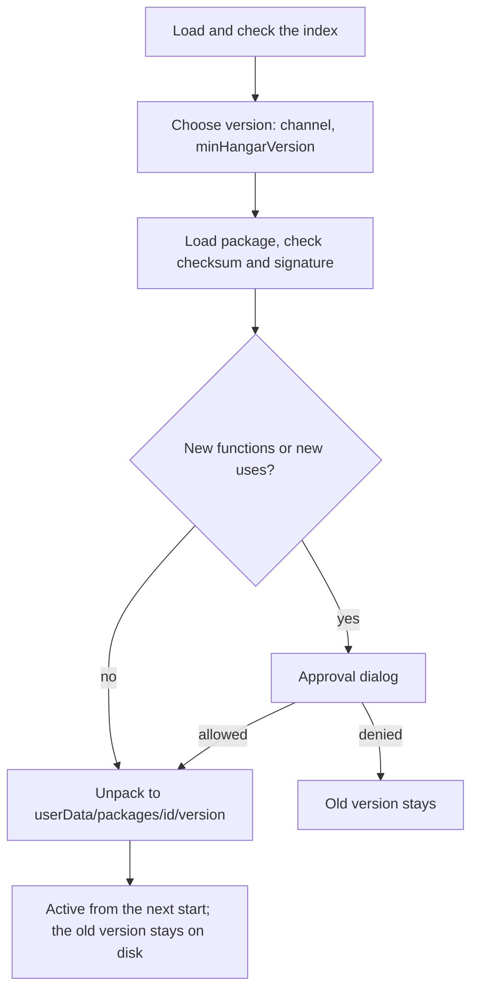

# Concept: bay registry

Status: draft, 2026-10-28. Decisions: [ADR 0012](adr/0012-registry.md).
Basis: [concept.md](concept.md), sections "Registry (separate
project)", "IDs and permissions" and "Update routines". No
production code.

## Goal

- Install, update, roll back and remove bays without rebuilding Hangar.
- Bay IDs stay unique.
- New functions or permissions of a bay trigger a new approval.
- At first only the maintainer develops bays; bays by third parties come later.

## Starting point in the code

- Bays live in fixed folders: in the package under `<app>/bays`, in development
  `bays/` of the repository, overridable with `HANGAR_BAYS_DIR`
  (`apps/desktop/src/main/host.ts:37`, ADR 0004).
- The manifest checks ID (reverse domain), version (SemVer 2.0.0, complete since
  `02c79f1`),
  `minHangarVersion`, paths inside the bay folder and functions
  (`packages/sdk/src/manifest.ts`). The bay loader detects duplicate IDs.
- **The main part of a bay runs in the main process** with all rights of Node
  (ADR 0004). A downloaded bay is therefore code with the rights of Hangar:
  files, network, processes, keychain access through Electron. This determines
  the whole security model below.
- The manifest declares which functions a bay **offers**, not which it
  **uses**. Permissions arise only on the first call (ADR 0006).

## Basic decision: two stages

| Stage | Who publishes       | Precondition                                                        |
| ----- | ------------------- | ------------------------------------------------------------------- |
| A     | only the maintainer | Signed packages, static index, installation and update in Hangar    |
| B     | third parties too   | main part in an operating system sandbox, review before publication |

Allowing bays by third parties without isolation would mean giving foreign code
full rights. A separate process alone is not enough for this: a
`utilityProcess` still has full Node access to files, network and processes.
Stage B therefore begins only when the main part runs in a process without these
rights (operating system sandbox, for example macOS Seatbelt, Linux with
seccomp/namespaces, Windows AppContainer) and talks to Hangar only through the
`BayContext` (as a MessagePort). Whether this is worth it for all three
platforms is open; until then, bays by third parties stay excluded.

## Package format

A bay is delivered as `<id>-<version>.bay`: a tar.gz with

```
manifest.json
icon.svg
dist/ui/…
dist/main/index.js        (optional)
```

- Packages bring no native modules; `dist/main` is a bundled ESM file. The host
  provides native modules (ADR 0004, today `node-pty` for the agent bay). The
  manifest names them in `hostModules`; Hangar installs only bays whose
  `hostModules` it brings in a matching version, and resolves them from the app
  package, never from `userData`.
- New manifest fields:
  - `publisher`: ID of the publisher (must match the prefix of the bay ID, see
    below).
  - `uses`: functions of other bays that the bay calls
    (`["dev.hangar.browser/page.open"]`). Hangar shows them on installation and
    update; the bus rejects calls by the bay itself (`Caller` `kind: 'bay'`)
    outside this list. Agents in sessions ask on first access as before
    (ADR 0006), because their calls are not in the bay's code. This makes the
    "new permissions" that the concept demands recognisable.
  - `agentSessions: true`: only then may the bay use `registerAgentSession`.
    Otherwise any bay could issue itself a session token and thereby call as an
    agent, bypassing `uses` (`bay-runtime.ts:88`, `tokens.ts:9`). Hangar shows
    the capability on installation and update.

## Signature and index

- Every version has a SHA-256 checksum and an Ed25519 signature of the
  publisher.
- An **index** (`index.json`) lists, per bay, the versions with channel
  (`stable`, `beta`), checksum, size, `minHangarVersion` and URL. The index
  itself is signed and carries an expiry date (for example 14 days). An outdated
  index is rejected (protection against frozen updates); so is an index older
  than the last one seen (protection against downgrade).
- The public key of the index is built into Hangar. Key change: the old key
  signs the new one (model: TUF, simplified).
- **Publishers:** `publishers.json` binds, per publisher, prefixes and permitted
  signing keys (with validity and revocation) and is signed with the index key.
  Hangar checks: package signature from a permitted key of the publisher,
  `publisher` in the manifest equal to this publisher, ID of the bay under one of
  its prefixes.
- Stage A needs no server of its own: index and packages are static (for example
  GitHub Releases plus GitHub Pages).

## IDs

- A prefix belongs to a publisher, proven through the domain (`dev.hangar.*`
  would correspond to hangar.dev; who owns the domain: UNBEKANNT). Stage A: only
  `dev.hangar.*`, entered permanently.
- Stage B: publishers register their prefix with a DNS TXT proof; the registry
  rejects IDs outside a confirmed prefix.
- Same ID: a registry version replaces a bundled bay if it is signed by the same
  publisher and is newer (so `dev.hangar.agents` also gets updates). Hangar
  rejects other collisions and names both locations; a local development bay
  (`HANGAR_BAYS_DIR`) always takes precedence.

## API v1

Static in stage A, as a service in stage B; same paths:

| Path                                  | Content                      |
| ------------------------------------- | ---------------------------- |
| `GET /v1/index.json`                  | signed index of all bays     |
| `GET /v1/bays/<id>/<version>.bay`     | package                      |
| `GET /v1/bays/<id>/<version>.bay.sig` | signature of the package     |
| `GET /v1/publishers/<publisher>.json` | public keys of the publisher |

A new major version of the API gets a new path (`/v2`); Hangar always supports
the current and the previous one.

## Installation, update, rollback



- Storage: `<userData>/packages/<id>/<version>/`, plus
  `<userData>/packages/<id>/active` with the active version. Separate from the
  data folder of the bay (`<userData>/bays/<id>`, `dataDir`), so that a bay
  cannot change its own code; only the host writes there. The bay loader reads
  this folder in addition to the bundled bays.
- "New permissions" covers: new functions, new `uses`, `agentSessions`, new
  `hostModules` and functions that newly become `sensitive`. For the latter,
  Hangar resets stored `allow` permissions, so that it asks again on the next
  call.
- The version switches at the next start; a switch during operation
  (`deactivate` → `activate`) later, once it is safe for sessions.
- Rollback: the previous version stays on disk; "roll back" resets `active`.
  Older versions are deleted after the second successful start of the new one.
- **Data on version change:** code and data must go back together. The manifest
  carries `dataVersion` (integer). If it changes, Hangar backs up the data
  folder before the first start of the new version; rolling back restores this
  backup (data since the update is lost in the process, the dialog says so). A
  bay migrates only forward.
- Check for updates at start and daily (through the scheduler, roadmap
  phase 4); never install without confirmation.
- Removing asks whether the data of the bay (partition `persist:bay:<id>`, data
  folder) should stay.

## UI

- List in the Hangar overview: installed bays with version, origin (bundled,
  registry, local), update available, roll back, remove.
- Catalog: available bays with description, publisher, `uses`.
- Approval dialog on installation and update: new functions, new `uses`,
  publisher.

## Threat model

| Threat                                  | Measure                                                                                                                                                  |
| --------------------------------------- | -------------------------------------------------------------------------------------------------------------------------------------------------------- |
| Package tampered with on the way        | Checksum and signature                                                                                                                                   |
| Index tampered with                     | Signed index, built-in key                                                                                                                               |
| Frozen or old updates                   | Expiry date and version counter of the index                                                                                                             |
| Malicious bay by a third party          | Stage B only with an isolated main part and review                                                                                                       |
| Bay obtains permissions by stealth      | `uses` in the manifest, bus rejects anything not declared, approval on change                                                                            |
| Bay bypasses `uses` in the main process | Only an operating system sandbox closes this; in stage A only own bays                                                                                   |
| ID of a foreign bay hijacked            | Prefix proof; local and bundled bays take precedence                                                                                                     |
| Path escape on unpacking                | Own check per entry: no absolute, drive or UNC paths, no `..`, only files and folders (no links); target path inside the package folder after `realpath` |
| Decompression bomb                      | Limits on unpacking: 50 MB unpacked, 2000 entries, 20 MB per file; only expected file types                                                              |
| Bay issues itself a session token       | `agentSessions` in the manifest, otherwise no `registerAgentSession`                                                                                     |
| Function becomes sensitive later        | Comparison on update, old `allow` permissions reset                                                                                                      |

## Open questions

- Domain for the registry and the publisher proof.
- Should bays also be installable from a file (development, company-internal),
  then with a warning "not signed"?
- Paid bays: not planned.

## Proposal for the implementation

1. Manifest: `publisher`, `uses`, `agentSessions`, `hostModules`,
   `dataVersion`; bus rejects anything not declared, `registerAgentSession` only
   with `agentSessions` (red tests first). Works without a registry too.
2. Build the package (`pnpm pack:bay <id>`) and sign it; the check in its own
   module with tests (signature wrong, checksum wrong, path escape, index
   expired).
3. Installation and rollback from a local index (E2E).
4. Static index on GitHub Releases/Pages, update check through the scheduler.
5. Stage B: main part in an operating system sandbox (own decision, own ADR),
   then publisher registration.
