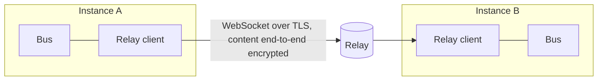

# Concept: Hangar Relay

Status: draft, 2026-10-28. Decisions: [ADR 0011](adr/0011-relay.md).
Basis: [concept.md](concept.md), section "Hangar Relay (after the MVP)".
No production code; this document is the template for later phases of the
[roadmap](roadmap.md).

## Goal

Several Hangar instances work together through a relay server, also across
people:

- Agents on different machines report status, summaries and results into a
  shared workspace.
- One instance calls shared functions of another instance, for example a
  handover to an agent of a colleague.
- Remote calls are blocked by default.

**Non-goals of the first stage:** file synchronisation, shared terminals
(screen sharing of a shell), the relay as a data store, access from the browser
without Hangar.

## Terms

| Term      | Meaning                                                                                                          |
| --------- | ---------------------------------------------------------------------------------------------------------------- |
| Instance  | One Hangar installation with its own key pair. ID = fingerprint of the public key.                               |
| Person    | A human who owns one or more instances; logs in at the relay.                                                    |
| Relay     | Server that forwards messages between instances. Sees routing data, no content.                                  |
| Workspace | Group of instances with a common share list and a common event stream; an instance can be in several workspaces. |

## Starting point in the code

- The bus routes every call through a `Transport` interface
  (`packages/bus/src/types.ts:33`); `registerTransport` registers a function
  with any transport (`packages/bus/src/bus.ts:70`). A relay transport only has
  to implement `invoke`; the permission check stays in the bus.
- `Caller` knows only `bay` and `session` (`packages/bus/src/types.ts:2`).
  ADR 0006 plans to extend it by the remote instance.
- The rule "own bay may do everything non-sensitive" compares only `bayId`
  (`packages/bus/src/bus.ts:134`). A remote caller with the same bay ID (for
  example `dev.hangar.agents` on both machines) would satisfy it today. **This
  must be closed before any relay implementation.**
- Function IDs are `<bay-id>/<function>`; a second registration of the same ID
  throws (`packages/bus/src/bus.ts:72`). So the same bay on two instances
  collides.
- The MCP server listens only on `127.0.0.1` (`packages/mcp/src/server.ts:34`)
  and maps tokens to sessions (`packages/mcp/src/tokens.ts`). The relay changes
  nothing here: it is an outgoing connection of the instance, not an open port.

## Architecture

- **Relay client** in the main process of Hangar (own package `packages/relay`,
  without an Electron dependency like `packages/bus`). It holds one outgoing
  WebSocket connection, registers remote functions on the bus and answers
  incoming calls through `bus.call`.
- **Relay server** as its own small Node service (separate deployment,
  self-hostable). It forwards, stores no content and holds only accounts,
  workspace memberships and public keys.

## Identity and trust

1. **Instance keys:** When first switched on, Hangar creates an Ed25519 key pair
   (signature) and an X25519 key pair (key exchange). Both public keys are in an
   **identity document** `{ v, ed25519, x25519, name, created }`, which the
   instance signs with its Ed25519 key; the fingerprint is the SHA-256 of this
   document. So a confirmation of the fingerprint also covers the encryption
   key. The private part is stored encrypted in the data folder, protected by
   Electron's `safeStorage`. Its protection depends on the operating system: on
   Linux only `gnome_libsecret` or `kwallet*` counts as sufficient (with
   `basic_text` Hangar refuses the relay); on Windows DPAPI does not protect
   against processes of the same user.
2. **Login at the relay:** People log in (method open, see below). The login
   proves only who may open a connection, not whom an instance trusts.
3. **Trust between instances:** A workspace has no key of its own. Its state is
   a **member list**
   `{ workspace, version, members: [identity document], revoked: [fingerprint] }`,
   which the changing member signs; each instance stores the highest version it
   has seen and rejects older ones. Joining: the invitation contains the
   fingerprint of the inviting instance; the joining one checks it against the
   identity document, the inviting one confirms the fingerprint of the new one in
   turn (comparison over a second channel) and signs the new list. The relay only
   distributes the list; without a valid signature of a member, no instance
   accepts it. A compromised relay therefore cannot slip in an instance.
4. **Revocation:** Any member can remove an instance; the new list carries it
   under `revoked`, and the entry stays permanently. **Limit:** A compromised
   relay can withhold the new list. Instances therefore compare the version with
   each other at every connection setup (`hello` names it, the other side
   delivers a newer signed list along with it), and calls are valid only while
   the caller's list is at most seven days old. A lost machine is thus locked out
   after seven days at the latest, immediately if members are reachable.

## Encryption

- Transport to the relay: WebSocket over TLS.
- Content: end-to-end between instances (libsodium):
  - **Key per pair:** X25519 between sender and target; from it, HKDF-SHA256
    derives one key per direction; `info` contains workspace, both fingerprints
    and the protocol version.
  - **Encryption:** XChaCha20-Poly1305 with a random 192-bit nonce per message
    (a repeat is negligible at this length). The header
    `{ v, workspace, from, to, seq, epoch, ts }` enters in canonical form (sorted
    keys, UTF-8, no whitespace) as additional authenticated data; the relay can
    read it but not change it.
  - **Signature:** Ed25519 over `header || nonce || ciphertext`.
    Events to the whole workspace are encrypted individually per target
    instance; for small workspaces (under 20 instances) this is enough. Group
    encryption (MLS) only when workspaces grow larger.
- Against replay: every message carries an **epoch** (random per connection
  setup of the sender), a running number per sender-target pair and epoch, and a
  timestamp. The receiver stores the last accepted epoch and number per sender
  **durably, before** it executes a call (atomic write), and discards smaller
  ones, duplicates and messages older than five minutes. It recognises a replay
  with a new number by the call ID (remembered for five minutes).
- The relay sees: workspace, sender and target instance, size, time. Not:
  function names, arguments, results, summaries.

## Protocol

Messages as JSON in an envelope `{ v, workspace, from, to, seq, ts, body }`;
`body` is the encrypted content.

| Message    | Purpose                                                                                          |
| ---------- | ------------------------------------------------------------------------------------------------ |
| `hello`    | Connection setup; the client names its protocol versions, the relay picks the highest common one |
| `announce` | Instance reports the functions it shares for the workspace (name, description, schema)           |
| `call`     | Call of a shared function with call ID and time limit                                            |
| `result`   | Result or error for a call ID                                                                    |
| `event`    | Status, summary or result of a session to the workspace                                          |
| `revoke`   | Instance removed from the workspace                                                              |

**Versions:** As in [concept.md](concept.md) ("Update routines"), client and
server negotiate the protocol version at connection setup; the server always
supports the previous version too.

**Limits:** Messages at most 1 MB, calls at most 60 s, at most 10 open calls per
instance to another instance. Exceeding a limit is answered with an error, not
silently dropped.

## Mapping to the bus

- **New caller:** `Caller` gets the kind
  `{ kind: 'remote'; instance; workspace; bayId; sessionId? }`; `instance` is
  the fingerprint, `workspace` comes from the authenticated header. The "own
  bay" rule (`bus.ts:134`) never applies to remote callers. A remote `sessionId`
  is display only and is never treated as a local session.
- **Check before every execution**, independent of stored permissions: the
  caller is a member of the workspace according to the current list, the
  function is in its share list and is not sensitive. Only then does the stored
  permission apply. Whoever takes a function out of the share list or removes an
  instance blocks it at once, even with an existing `allow`.
- **Permissions:** The subject of a remote permission is
  `remote:<fingerprint>/<bay-id>`; permissions apply per instance, not per
  workspace. Without a stored permission Hangar asks (see below).
- **Namespace of remote functions:** Remote functions are registered under
  `remote.<short>.<bay-id>/<function>`; `<short>` is a name for the instance
  assigned by the user (for example `anna-laptop`), unique per Hangar and
  **display only**. Permissions for outgoing calls hang on the fingerprint: if
  `anna-laptop` gets a different key, old permissions no longer apply. So that
  local bays do not collide, the manifest reserves the prefix: the check rejects
  IDs that begin with `remote.`.
- **Handler contract:** A function is callable remotely only if its manifest
  entry carries `remote: true`. The current functions of the agent bay require a
  local session (`functions.ts:24`) and stay local.
- **Share list per workspace:** Which local functions a workspace may see is
  decided by the person; empty at first. Sensitive functions cannot be shared.
  `announce` contains only shared functions.
- **Prompt on first access:** If a shared function calls a remote instance for
  the first time, Hangar asks as it does locally (the dialog names person,
  instance and workspace). The answer is stored for this subject.
- **Arguments are foreign input:** As with local calls (`FunctionHandler`,
  `types.ts:13`) the handler checks them; in addition the relay client checks
  against the function's `inputSchema` before it calls `bus.call`.

## Workspaces: status and summaries

- The agent bay sends an `event` on status change and description to every
  workspace in which the session is shared (sharing per project, off by
  default).
- Received events are shown by a workspace view of the agent bay (instance,
  project, session, status, summary). They are data of foreign agents: if an
  agent passes them on, they are marked as remote origin (protection against
  prompt injection through summaries).

## Handovers

Handovers between agents do not exist locally yet (see concept.md,
"Coordination and summary"). Order: first locally as a bay function (for
example `dev.hangar.agents/handover.create` with branch, task, context), then
remotely through the same function in the share list. A remote handover
transfers only text and Git references (remote, branch), never files.

## Threat model

| Threat                            | Measure                                                                            |
| --------------------------------- | ---------------------------------------------------------------------------------- |
| Relay compromised                 | E2E encryption and signatures; trust only after fingerprint confirmation           |
| Relay changes or replays          | Signature, running numbers, time window                                            |
| Foreign instance calls everything | Default `deny`, share list, separate subjects per instance, no sensitive functions |
| Same-named bay as a back door     | "Own bay" rule never applies to `remote`; prefix `remote.` reserved                |
| Renamed or re-keyed instance      | Permissions on the fingerprint, name display only                                  |
| Stolen machine                    | Revocation in the signed list, delayed by at most seven days; `safeStorage`        |
| Restart as a replay gap           | Epoch and number durable before execution; call ID                                 |
| Overload by one instance          | Size, time and parallelism limits; relay throttles per connection                  |
| Prompt injection through events   | Mark origin; events never trigger calls themselves                                 |
| Metadata at the relay             | Stays visible; self-host if that is not acceptable                                 |

## Operation

- Relay server as a container, one instance is enough at the start; state
  (accounts, memberships, public keys) in SQLite.
- Health: `/health` and metrics (connections, messages, errors); no content in
  logs.
- Without a connection to the relay Hangar keeps working normally; remote
  functions disappear from the bus and return on reconnect.

## Open questions

- Login at the relay: magic link by email, GitHub OAuth, or both?
- Who operates the public relay, and is there one?
- From which workspace size is MLS worth it instead of pairwise encryption?
- Should a workspace also be able to share only events (without calls)?

## Proposal for the implementation

1. Bus: `Caller` `remote` with workspace, "own bay" rule only locally, check of
   membership and share before the stored permission, prefix `remote.` reserved
   in the manifest, `remote: true` per function; tests (red first). Usable and
   testable without a network.
2. `packages/relay`: envelope, signature, encryption, numbers; tests with two
   clients in the same process.
3. Relay server with login, workspaces, forwarding; integration test with two
   Hangar buses.
4. UI: workspaces, invitation with fingerprint, share list, event view.
5. Handovers locally, then remotely.
