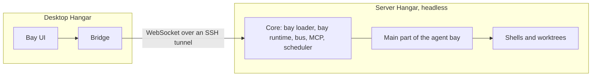

# Concept: Hangar on a server

Status: draft, 2026-10-28. No ADR yet; one follows on implementation.
Reference: [roadmap.md](roadmap.md) phase 4 (scheduler),
[concept-relay.md](concept-relay.md). No production code.

## Goal

- One Hangar runs permanently on its own server (VM, home server), without a
  screen.
- Jobs and agent sessions keep running there even when the laptop is closed:
  nightly tests, long agent tasks, regular queries.
- The desktop app shows this server like another source of bays: sessions,
  terminals, status bar, job list and results.
- One person, one server. Several people on one server are not a goal.

## Is it worth it?

Yes, if agents are meant to work unattended. Phase 4 specifies that jobs run
only while Hangar runs on the machine; a sleeping laptop misses them. A server
solves exactly that, and Hangar brings there what a bare cron job lacks: a
worktree per session, MCP functions, status, status bar and the same view as
locally.

It is not needed for plain scripts without an agent (tests, builds): CI with a
schedule (for example GitHub Actions `schedule`) or a cron job is enough for
those. And for interactive work, the local Hangar stays faster.

The effort is manageable because the core parts already run without Electron
(see below). Three things are expensive: the bridge between the bay UI and the
remote main part, permission dialogs without a screen, and the safe operation of
a machine on which agents have shells.

## Starting point in the code

- `packages/bus` and `packages/mcp` have no Electron dependency
  (`packages/bus/CLAUDE.md`). The MCP server listens only on `127.0.0.1`
  (`packages/mcp/src/server.ts:34`).
- The bay runtime imports no Electron. Everything a UI needs comes through
  `HostServices` (`apps/desktop/src/main/bay-runtime.ts:9`): `notify`,
  `badgeChanged`, `pickFolder`, `sendToUi`, `registerAgentSession` and others.
  The bay loader (`bay-loader.ts`) needs only `node:fs` and the manifest.
- The main part of the agent bay uses only `BayContext`, `node-pty` and Git
  (`bays/agents/src/main/`). The only place that requires a dialog: "Add project"
  calls `ctx.pickFolder` (`bays/agents/src/main/index.ts:40`).
- Electron lives only in `host.ts` (window, views, IPC, tray), `index.ts`
  (start), `prompter.ts` (permission dialog) and `updates.ts`.
- Permission dialogs are shown by `dialogPrompter`
  (`apps/desktop/src/main/prompter.ts:54`). Since phase 3, permissions can be set
  in advance (`Bus.setMode`).

## Architecture

1. **Core as a package:** What runs today in `apps/desktop/src/main` without
   Electron (bay loader, bay runtime, wiring of bus, MCP and scheduler,
   settings) moves to `packages/host`. The desktop app supplies the Electron
   parts of `HostServices`, the server its own.
2. **`apps/server`:** Node process `hangar-server --data <folder> --listen
127.0.0.1:<port>`. Loads bays, starts MCP and scheduler, has no UI. Runs as a
   systemd service or container.
3. **Bridge:** Today the bay UI talks to its main part through
   `window.hangar.invoke`/`on` (IPC). For a remote bay, the desktop app loads
   the same UI from the local bay bundle, but the preload forwards
   `invoke`/`on` over a WebSocket connection to the server. The bay notices
   nothing; the channels (`state`, `project.add`, terminal data …) stay the
   same. Precondition: same bay version on both sides, otherwise the sidebar
   shows "Version does not match".
4. **Sidebar:** A connected server appears as its own group in the sidebar
   ("Server: homeserver") with its bays. Local and remote bays stand side by
   side.

## HostServices on the server

| Service                | Desktop             | Server                                                                                                       |
| ---------------------- | ------------------- | ------------------------------------------------------------------------------------------------------------ |
| `sendToUi`             | IPC to view/window  | to all connected desktops; without a connection no effect, the state stays in the main part                  |
| `notify`               | system notification | to connected desktops; otherwise collected and shown on the next connect                                     |
| `badgeChanged`         | sidebar, app icon   | to connected desktops                                                                                        |
| `pickFolder`           | native dialog       | path input in the UI; the server checks that the path lies under a shared root folder                        |
| Permission dialog      | `dialogPrompter`    | forwarded to a connected desktop; without a connection `deny`, the job reports "blocked: permission missing" |
| `registerAgentSession` | MCP on 127.0.0.1    | unchanged, MCP stays local on the server                                                                     |

For unattended jobs this means: set permissions beforehand (settings, phase 3).
A job that hangs on a question does not wait but ends with a clear reason.

## Jobs on the server

- The scheduler from phase 4 belongs in the core (`packages/host`), so that the
  same code runs locally and on the server. **Consequence for phase 4:** the
  scheduler must not import Electron.
- A job of the agent bay starts a session in a new worktree and runs a command
  there, for example `pnpm test` or an agent without questions
  (`claude -p "…"`). Result: exit code, duration, last lines of the output; the
  full log is the scrollback of the session.
- The job list shows per run status, start, duration and a link to the session.
  The session stays after the run until it is closed or a retention period
  (default seven days) expires.
- If no desktop is running, results collect on the server; on connect, Hangar
  shows what has run since.

## Connection and security

- **No open ports:** The server listens only on `127.0.0.1`. The desktop reaches
  it through an SSH tunnel (`ssh -L`) that Hangar sets up itself, or through a
  private network (for example Tailscale). Login thus stays with the user's SSH
  key.
- **Pairing:** On first connect, the server shows a fingerprint of its key
  (identity document as in [concept-relay.md](concept-relay.md)); the desktop
  stores it. After that, every connection carries a token that the server has
  issued.
- **The server is a workbench, not a vault:** Agents have a shell there. Own
  machine or own VM, own user, Git access through deploy keys per repository
  instead of personal keys, API keys only as environment variables of the
  service.
- **Limits:** An agent on the server can do anything the service user can.
  Hangar does not restrict this further; the sandbox is the machine.

## Operation

- Data: one folder (`--data`) with `permissions.json`, settings, bay data,
  worktrees; backup through this folder.
- Service: systemd unit with `Restart=always` or container with a volume. On
  restart the agent bay restores sessions as today (`manager.restore()`).
- Health: `GET /health` on 127.0.0.1 and a log without the content of the
  terminals.
- Updates: desktop and server check the protocol version on connect; the server
  supports the current and the previous one (as with the relay).

## Open questions

- Decided (2026-10-29): A subscription login is permitted only while the agent
  client runs on one's own notebook. Agents on the server log in with an API key
  (environment variable of the service). Narrowed 2026-11-11 (ADR 0041): a
  server the app sets up on the person's own Linux machine runs under their
  user and may use their subscription login.
- Will a web UI (phone) be needed later, or is the desktop enough?
- Should the server also be the relay instance of a workspace, or does the
  desktop–server connection stay its own, simpler path?

## Proposal for the implementation

1. Build phase 4 (scheduler) without an Electron dependency. Done:
   `packages/scheduler` (ADR 0013).
2. Move the core to `packages/host`, desktop uses it; no new behavior, all E2E
   green.
3. `apps/server` with permissions only from rules (without a dialog),
   integration test: job of a test bay runs without UI and without Electron.
4. Bridge: preload for remote bays, WebSocket protocol with version, SSH tunnel
   from the desktop app; E2E with a locally started server.
5. Forward permission dialog and notifications to the desktop; path instead of
   folder dialog in the agent bay.
6. Operation: container image, systemd example, docs.
